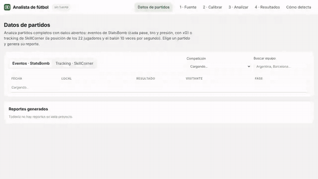

# Analista de fútbol

**Del partido a los datos.** Analista lee un partido desde el video (la señal del televisor por una capturadora HDMI, una
grabación o la pantalla del PC) y ubica a cada jugador y el balón en metros. Con eso, y con datos abiertos de eventos
(StatsBomb) y de tracking (SkillCorner), calcula xG, posesión, presión, formación y control de cancha, y entrega
reportes listos para compartir.

[](https://github.com/jazaineam1/analista-futbol/actions/workflows/pruebas.yml)




[Sitio](https://jazaineam1.github.io/analista-futbol/) ·
[Guía de uso](https://jazaineam1.github.io/analista-futbol/guia.html) ·
[Cómo detecta, etapa por etapa](https://jazaineam1.github.io/analista-futbol/deteccion/) ·
[Video de la demo](docs/media/demo.mp4)

## Qué analiza

| Fuente | Qué trae | Qué sale |
|---|---|---|
| **Tu video** (archivo, capturadora HDMI, pantalla, `rtsp://`) | Lo que se ve en la imagen | Posiciones en metros de los jugadores y el balón, equipos por color, posesión, pases, presión, bloque, físico, goles, video anotado con minimapa |
| **Eventos · StatsBomb Open Data** | Casi 4.000 partidos: cada pase, tiro, presión y duelo | xG (de StatsBomb y de un modelo propio), flujo de xG, mapa de tiros, redes de pases, PPDA, field tilt, pases progresivos |
| **Tracking · SkillCorner Open Data** | 20 partidos de la A-League 2024/25, 22 jugadores y balón a 10 Hz | Posesión, altura del bloque, ancho, formación sin balón, control de cancha en los goles, distancia y velocidad máxima |

Todo llega al mismo esquema (metros, origen en el centro de la cancha, `A` local y `B` visitante), así que el mismo
código analiza cualquiera de las tres fuentes.

## Empezar

```bash
pip install "analista-futbol[todo] @ git+https://github.com/jazaineam1/analista-futbol"
analista panel
```

El panel se abre en el navegador (`http://localhost:8765`) con seis pestañas: **Datos de partidos**, **Fuente**,
**Calibrar**, **Analizar**, **Resultados** y **Cómo detecta**. No sube nada a internet.

Desde la línea de comandos:

```bash
analista datos statsbomb reporte 3869685 --competicion 43 --temporada 106   # final del Mundial 2022
analista datos skillcorner reporte 1886347                                    # Auckland FC – Newcastle Jets
analista analizar partido.mp4 -c calibracion.json -o resultados               # tu video
analista vivo disp:0 -c calibracion.json                                      # en vivo, desde la capturadora
```

Y desde Python:

```python
from analista import Partido
from analista import graficos as gr

final = Partido.statsbomb(3869685)
final.resumen()["por_equipo"]["A"]["xg"]      # 2.76
gr.red_de_pases(final, "A")

aleague = Partido.skillcorner(1886347)
aleague.formacion("A")["formacion"]
gr.control_de_cancha(aleague, t=5059.9)

mio = Partido.video("resultados/")
mio.reporte("mi_partido.html")
```

Hay notebooks de ejemplo en [`notebooks/`](notebooks) y la [guía](docs/guia.html) explica cómo conectar el televisor,
calibrar bien y qué mide cada métrica.

## Resultados medidos

<!-- VALIDACION -->
Medido contra la verdad de cada cuadro en dos transmisiones generadas con el tracking real de SkillCorner (ver [validación](https://jazaineam1.github.io/analista-futbol/#validacion)):

| Medida | Plano completo (cámara fija) | Cámara de TV (paneo y zoom) | Qué significa |
|---|---|---|---|
| Jugadores detectados | 97,4% | 91,1% | de los que se ven en cada cuadro |
| Detecciones correctas | 99,4% | 86,7% | lo detectado que era un jugador real, a ≤2 m |
| Error de posición | 0,13 m | 0,55 m | mediana; el 90% bajo 0,22 m y 1,59 m |
| Equipo correcto | 99,5% | 95,4% | jugadores de campo, por el color de la camiseta |
| Identidad estable | 99,0% | 91,4% | una pista sigue siempre al mismo jugador |
| Balón ubicado | 36% | 44% | cuadros con balón visible en que la app lo ubica a ≤2 m |
| Cámara calibrada | 100% | 100% | error mediano en la cancha: 0,06 m y 0,97 m |
| Posesión de Auckland | 57% / 90% | 61% / 84% | estimada / real, en los cuadros analizados |
| Goles detectados | 1 de 1 | 2 de 2 | el balón cruza la línea entre los postes (±2 s) |
| Velocidad | 1,4 cuadros/s | 3,2 cuadros/s | CPU de 2 núcleos sin GPU, a 1920 y 1280 px |
<!-- /VALIDACION -->

## Cómo funciona con video

1. **Césped y zona de juego**: lo verde forma la cancha; tribuna, bancos y gráficos de TV quedan fuera.
2. **Líneas**: las líneas blancas pintadas, con un filtro morfológico.
3. **Calibración**: una homografía de 4 o más clics, ajustada contra las líneas; con cámara de TV se sigue el paneo y el
   zoom con flujo óptico y se re-ancla tras un corte.
4. **Personas**: YOLO marca a cada persona; las que están fuera de la cancha se descartan.
5. **Equipos**: color del torso en espacio Lab y k-means, sin entrenar nada; árbitro y arqueros quedan como "otro".
6. **Balón**: candidatos de la red y manchas claras y redondas sobre el césped, con un seguidor que exige coherencia.
7. **A metros**: el pie de cada jugador se proyecta a la cancha.
8. **Seguimiento**: Kalman y asociación en dos etapas en metros, para que cada jugador conserve su número.
9. **Métricas**: posesión por proximidad, pases, presión, bloque, forma, físico, eventos de gol.
10. **Reporte**: HTML autocontenido y tablas CSV.

La pestaña **Cómo detecta** muestra cada etapa sobre el cuadro que elijas.

## Estructura

```
analista/
  vision/      del cuadro de video a posiciones en metros (fuentes, cámara, detección, equipos, seguimiento)
  datos/       StatsBomb, SkillCorner y resultados de video en el esquema común
  analisis/    métricas de eventos y de tracking, modelo xG
  reportes/    reportes HTML
  panel/       panel web local (Flask)
  partido.py   API de alto nivel: Partido.statsbomb / .skillcorner / .video
  graficos.py  gráficos con matplotlib
demo/          scripts que generan los ejemplos, la validación, el sitio y el video de la demo
docs/          sitio (GitHub Pages)
notebooks/     ejemplos en Jupyter
tests/         pruebas (pytest)
```

## Desarrollo

```bash
pip install -e ".[todo,dev]"
pytest            # 26 pruebas, sin internet ni GPU
ruff check analista tests demo
```

Para regenerar los ejemplos y la validación:

```bash
python demo/extraer_sprites.py --videos left_camera.mp4 right_camera.mp4 --modelo yolo11s.pt
python demo/generar_transmision.py --camara completa --tramos 50377-50657 -o demo/clips/completo
python demo/generar_transmision.py --camara tv --tramos 50377-50657,53770-53858 --marcadores 0-0,1-0 -o demo/clips/tv
analista analizar demo/clips/tv/video.mp4 -c demo/clips/tv/calibracion.json -o demo/salidas/tv
python demo/evaluar.py --resultados demo/salidas/tv --gt demo/clips/tv
python demo/construir_sitio.py
```

## Límites

- **Protección de contenido**: la app lee solo lo que tu equipo puede reproducir. Una señal con HDCP se ve negra en la
  capturadora y la app no la evita.
- **Detector general**: YOLO entrenado con COCO no distingue arquero, árbitro y jugador. Un modelo afinado para fútbol
  mejoraría la detección del balón y de los jugadores lejanos.
- **Balón en el aire**: con una sola cámara no se puede ubicar en metros.
- **Deriva de la cámara de TV**: siguiendo el paneo, la calibración se desvía con el tiempo (en la prueba, 1 m de error mediano en tomas de hasta 28 s). Calibrar cada toma lo reduce.
- **Posesión con balones aéreos**: un balón alto se proyecta al suelo lejos de donde está; en centros y remates desvía la posesión.

## Datos y licencias

- Código: MIT. El detector opcional usa [Ultralytics YOLO](https://github.com/ultralytics/ultralytics) (AGPL-3.0).
- [StatsBomb Open Data](https://github.com/statsbomb/open-data): uso educativo y de investigación, citando a Hudl StatsBomb.
- [SkillCorner Open Data](https://github.com/skillcorner/opendata): MIT.
- [SoccerTrack](https://github.com/keisuke198619/SoccerTrack): clip real de ejemplo y recortes de jugadores para las
  transmisiones sintéticas.
